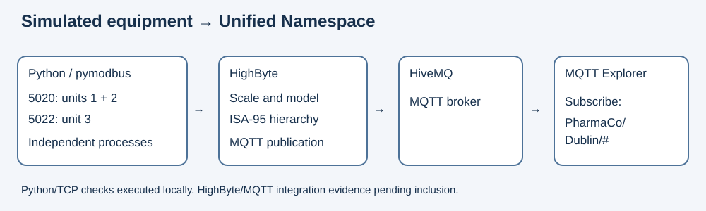

# UNS Bioreactor Simulator
A Python Modbus TCP simulation of two bioreactors and a chiller, intended for a HighByte → HiveMQ Unified Namespace learning pipeline.

## Architecture


## What it does
- Serves Bioreactor1 (unit 1) and Chiller1 (unit 2) on TCP 5020, plus Bioreactor2 (unit 3) on TCP 5022.
- Simulates scaled measurements, threshold flags, writable RPM and a chiller run command.
- Supplies device data for HighByte modelling and ISA-95 MQTT topic publication.

## Quick start (Windows PowerShell)
Python 3.10+ is required; validated here with Python 3.12.14 and pymodbus 3.12.0.

```powershell
git clone https://github.com/raihanadj/PharmaCo.git
cd PharmaCo
py -m venv .venv
.\.venv\Scripts\python.exe -m pip install -r requirements.txt
.\.venv\Scripts\python.exe src/run_simulators.py
```
You should see `Ready:` listing both ports, followed by changing temperature/pH and chiller values each second. Ctrl+C stops the simulator. Do not run the standalone scripts alongside the launcher on the same ports.

In another terminal in the repository:
```powershell
.\.venv\Scripts\python.exe tests/read_registers.py
.\.venv\Scripts\python.exe -m unittest discover -s tests -v
```
The live check prints PASS lines and temporarily writes RPM=150, restoring the original value afterwards. On Linux/macOS use `python3 -m venv .venv` and `.venv/bin/python` in place of the Windows executable.

Settings are environment variables, listed in `.env.example`; this file is a reference and is not loaded automatically. For example `$env:SIM_HOST="0.0.0.0"` enables connections from other machines. Default binding is localhost. In combined mode CHILLER_PORT must equal BIOREACTOR1_PORT. No MQTT credentials are needed to run Python.

## Register map
Addresses in code and the test client are zero-based; reference labels below are the conventional human-readable notation.

| Device | Reference | Offset | Meaning | Decode |
|---|---|---|---|---|
| Bioreactors | 30001 / 30002 | 0 / 1 | Temperature / pH | ÷10 / ÷100 |
| Bioreactors | 40001 | 0 | RPM setpoint (R/W) | integer |
| Bioreactors | 00001 | 0 | Heater flag | boolean |
| Bioreactors | 10001 | 0 | High-temperature alarm | boolean |
| Chiller | 30001 / 30002 / 30003 | 0 / 1 / 2 | Supply / return / flow | ÷10 / ÷10 / L/min |
| Chiller | 40001 | 0 | Supply setpoint (R/W) | ÷10 |
| Chiller | 00001 | 0 | Run command (R/W) | boolean |
| Chiller | 10001 / 10002 | 0 / 1 | Running / low-flow alarm | boolean |

See [register details](docs/register-map.md).

## Topic and tag naming
| Asset | Intended MQTT topic |
|---|---|
| Bioreactor1 | `PharmaCo/Dublin/Upstream/Line1/Bioreactor1` |
| Bioreactor2 | `PharmaCo/Dublin/Upstream/Line1/Bioreactor2` |
| Chiller1 | `PharmaCo/Dublin/Utilities/Line1/Chiller1` |

Subscribe to `PharmaCo/Dublin/#`. These are asset-level JSON topics; see [naming](docs/isa95-naming.md). Actual export and MQTT evidence are pending inclusion.

## Connect HighByte
1. Start the combined Python launcher.
2. Create Modbus TCP connections for localhost:5020, units 1 and 2, and localhost:5022, unit 3. If HighByte runs elsewhere, use the simulator machine's reachable address and configure SIM_HOST appropriately.
3. Map input registers, holding registers, coils and discrete inputs using the table above. Confirm whether the HighByte address field expects an offset or reference notation.
4. Decode temperatures by 10 and pH by 100; build instances for each asset.
5. Build the PharmaCo/Dublin namespace hierarchy and publish through the configured MQTT connection to HiveMQ.
6. Subscribe with MQTT Explorer and confirm changes. See [rebuild notes](highbyte/README.md).

## Screenshots
Pending: console, HighByte connection/model and MQTT Explorer tree. Automated text evidence is in [test evidence](docs/test-evidence.md).

## Demo video
Pending recording. Follow [the 3-minute script](docs/demo-script.md).

## What I learned and problems solved
- Two Unit IDs on one TCP port need one server with two device contexts; separate processes conflict on the bind.
- Scaled integers must be decoded before presentation: 372 represents 37.2 °C.
- An undefined variable in chiller alarm transition logging was corrected and regression checked.
- Dependency files accept package specifications; a Mosquitto command was removed from requirements.txt.

## Next steps
Capture HighByte/MQTT evidence, implement and test a physical cooling link between assets, record the demo, build a Windows executable and perform a fresh-machine check. This is a learning simulator using synthetic data. Chiller operation currently changes its own supply/return values only. Heater is a threshold flag, not a thermal model; RPM is stored and logged, not modelled mechanically. The fixed running flow of 45 L/min means low-flow faults cannot currently be induced through commands.

## Author and contact
[Raihan Ahmed](https://github.com/raihanadj).

## Release status
Source code is published in [raihanadj/PharmaCo](https://github.com/raihanadj/PharmaCo). The Windows executable and release are pending. See [release checklist](docs/release-checklist.md). Choose a licence before sharing for reuse.
